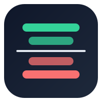

# Strata

**Systematic market-neutral factor portfolio for crypto perpetual futures — research, backtesting and paper trading.**

Built on free public Binance USDT-M Futures data (klines, funding history, full instrument list including delisted contracts).
Ranks a point-in-time liquid universe by momentum, reversal, volatility, liquidity, funding carry and BTC beta, and evaluates
dollar-neutral long/short books net of fees, slippage, funding and turnover. Results go to PostgreSQL and Telegram.

## Features

_In development (Stage 1). See [todo.md](todo.md)._

## Quick start

_Coming with Stage 1._

## Architecture

_Coming with Stage 1._

## Configuration

See [.env.example](.env.example).

## Roadmap

1. **Stage 1 — MVP + research:** point-in-time universe, factor library, cost-aware backtester, validity checks (walk-forward, 2x costs, random-signal benchmark, top-coin exclusion), experiment log, paper trading, Telegram alerts.
2. **Stage 2 — Production:** live execution, risk manager and kill-switch, CI/CD deploy to VPS. Only if Stage 1 passes Go/No-Go.
3. **Stage 3 — Analytics:** owner-only dashboard, factor attribution, backtest-vs-live tracking.

> All results are historical or simulated and are not a forecast or financial advice.
