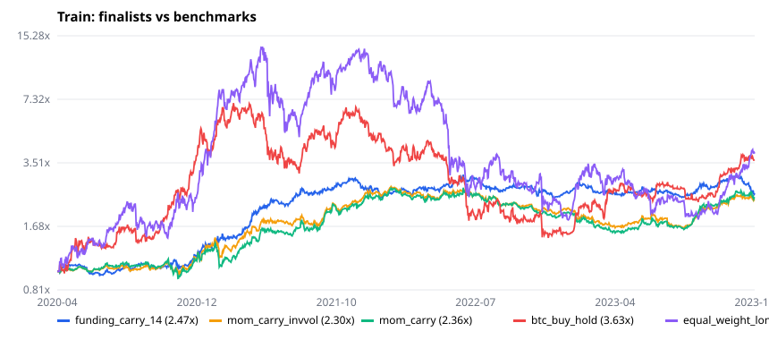
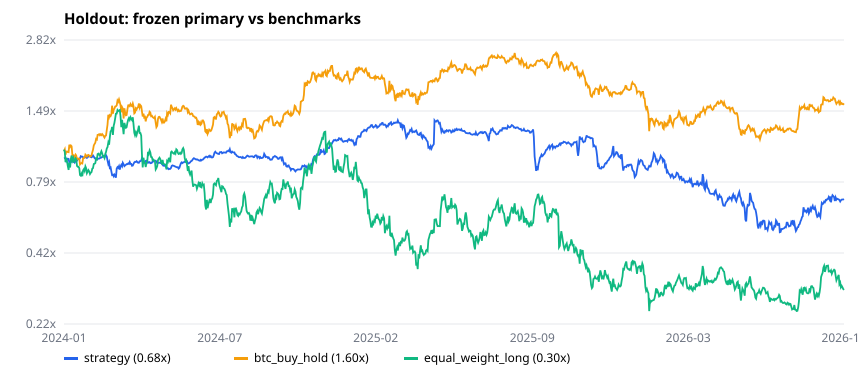

# Stage 1 — Go / No-Go report

**Verdict: No-Go.** The frozen primary strategy lost money on the untouched holdout; 1 of 9 criteria
met, including a failure of the mandatory "plus to deposit" criterion. Decision confirmed by the
owner on 2026-10-20.

> All figures are historical simulations, net of fees, slippage and funding. They are not a
> forecast and not financial advice.

## 1. Setup

| Item | Value |
|---|---|
| Market | Binance USDT-M perpetuals, crypto underlyings only (TradFi/USDC/quarterly excluded) |
| Data | Daily klines + funding, 2020-01-01 – 2026-10-19, 687 contracts incl. 164 delisted (data version `6902638c5419da9c`) |
| Universe | Point-in-time top-50 by 30-day quote volume, ≥ 60 days listed, ≥ $5M ADV |
| Book | Dollar-neutral, 10 long / 10 short, equal weight, 15% per-coin cap, gross 1.0x (primary scaled to 0.83x) |
| Timing | Signal at close of Sunday, fill at Monday open, funding over actual holding bars |
| Costs | Taker 5 bps + 5 bps base slippage + 0.1·√(order/ADV) impact; forced exit on delisting |
| Periods | Warm-up 2020-01..03 · train 2020-04-01 – 2023-12-31 · holdout 2024-01-01 – 2026-10-18 |
| Protocol | Pre-registered in `docs/research/protocol.md` before any real-data run |

## 2. Number of variations tried

18 distinct candidate specifications (pre-registered grid), plus 90 robustness runs (costs ×2,
walk-forward folds, coin exclusions) and 2 holdout runs: **110 logged runs** in
`docs/research/experiment-log.jsonl`. No specification was added or changed after results were seen.

## 3. Train period (selection)

| Spec | Sharpe | Annual | Vol | Max DD | Sharpe @2x costs | Deflated SR | Funding/yr | Costs/yr |
|---|---|---|---|---|---|---|---|---|
| funding_carry_14 | **1.12** | 27.2% | 24.1% | 24.0% | 0.92 | 0.22 | +20.0% | 4.8% |
| mom_carry_invvol | 1.02 | 24.9% | 24.8% | 38.5% | 0.79 | 0.17 | +12.6% | 5.9% |
| mom_carry | 0.98 | 25.7% | 27.1% | 40.8% | 0.77 | 0.15 | +14.4% | 5.6% |
| mom_carry_top30 | 0.70 | 16.9% | 28.0% | 30.6% | 0.52 | 0.05 | +10.7% | 5.0% |
| small_size_30 | 0.59 | 12.0% | 23.8% | 25.4% | 0.45 | 0.04 | −3.1% | 3.5% |
| all_six (weekly) | 0.38 | 6.8% | 26.5% | 44.5% | 0.14 | 0.01 | +3.9% | 6.6% |
| momentum_28 | 0.31 | 4.7% | 32.1% | 44.1% | 0.12 | 0.01 | +4.9% | 6.0% |
| low_vol_30 | −0.17 | −11.3% | 34.8% | 50.3% | −0.27 | 0.00 | −7.1% | 3.4% |
| all_six_daily | −0.59 | −18.2% | 27.5% | 63.7% | −1.24 | 0.00 | +4.7% | 18.3% |
| reversal_7_daily | −2.12 | −53.6% | 33.5% | 94.6% | −2.83 | 0.00 | −5.5% | 24.2% |

Full table: `docs/research/results/train.json`. Observations:

- Only carry-based specs cleared the Sharpe ≥ 0.5 at 2x costs filter; classic momentum, reversal and
  low-volatility factors did not work net of costs in 2020–2023.
- Daily rebalancing triples turnover; costs of 18–24% per year erase any edge.
- **Warning signs already on train:** deflated Sharpe of the best spec 0.22 (18 trials);
  walk-forward OOS Sharpe 0.40 (selection by past Sharpe, traded the next year).

Robustness of the finalists on train (`docs/research/results/robustness.json`):

| Finalist | Random-signal percentile | Sharpe excl. top 1/2/3 coins | Bull / bear / sideways Sharpe | Corr. BTC |
|---|---|---|---|---|
| funding_carry_14 | 99.9% (p95 random 0.42) | 0.89 / 0.99 / 0.87 | 1.53 / 3.12 / −0.25 | 0.01 |
| mom_carry_invvol | 99.8% | 0.88 / 0.93 / 0.88 | 1.17 / 1.23 / 0.73 | −0.05 |
| mom_carry | 99.5% | 0.84 / 0.68 / 0.73 | 1.04 / 1.21 / 0.82 | −0.03 |

Primary per protocol: `funding_carry_14`, leverage fixed from train vol: 0.20 / 24.1% = **0.83x**.

## 4. Holdout (opened once, 2026-10-20)

| Metric | funding_carry_14 @0.83x | Costs ×2 |
|---|---|---|
| Total return | **−32.1%** | −39.2% |
| Net return per month | **−1.15%** | −1.47% |
| Annual return | −12.9% | −16.3% |
| Annual volatility | 42.4% | 42.4% |
| Sharpe | −0.12 | −0.21 |
| Max drawdown | 63.2% | 65.2% |
| Funding income / yr | +40.9% | +40.9% |
| Costs / yr | 4.0% | 7.9% |

By year: 2024 **+13.6%**, 2025 **−10.8%**, 2026 YTD **−33.1%**. Regimes (BTC quarter): bull Sharpe
0.83, bear −1.12, sideways −0.44. Random-signal percentile 60.7% (p95 of random Sharpe 0.68).
Excluding the top 1–3 contributors: Sharpe −0.34 to −0.37. Correlation with BTC −0.13.

Largest losses came from shorts in coins with crowded long positioning that rallied hard
(MYX −$977, POWER −$578, PIPPIN −$435, 1000PEPE −$393 on a $3,000 book): funding income was real,
but price moves of squeezed shorts dominated it.

Benchmarks over the same period: BTC buy-and-hold +59.7% (max DD 53.7%); equal-weight long top-50
−69.8% (max DD 83.4%).

## 5. Criteria

| Criterion | Threshold | Holdout value | Result |
|---|---|---|---|
| Plus to deposit (mandatory) | > 0% per month (1.5% reference) | −1.15% per month | ❌ |
| Annual return | ≥ 20% | −12.9% | ❌ |
| Max drawdown (gross ≤ 2x) | ≤ 25% | 63.2% | ❌ |
| Sharpe | ≥ 1.0 | −0.12 | ❌ |
| Sharpe at 2x costs | ≥ 0.5 | −0.21 | ❌ |
| Better than random signals | ≥ 95th percentile | 60.7th | ❌ |
| Max single-coin profit share | ≤ 15% | 8.7% | ✅ |
| Positive rolling 6-month windows | ≥ 60% | 44.4% | ❌ |
| Paper vs backtest deviation (≥ 28 days) | ≤ 25% | not evaluated | — |

The paper-trading account ran for one day before the verdict; the reconciliation criterion was not
evaluated in production. On synthetic data the paper engine reproduced the backtest within 6.5%
(unit test `tests/unit/paper/test_paper.py`).

## 6. Risks and limitations of this study

- Single venue (Binance); TradFi perpetuals excluded; daily bars only.
- Slippage is modelled, not measured; impact on small caps may be understated in fast markets.
- Delisted positions exit at the last traded close; real settlements can be worse.
- The holdout coincides with a meme-coin cycle with extreme short squeezes; a different regime
  could look different, but the protocol does not allow re-selection on this data.
- With 18 candidates and a deflated Sharpe of 0.22, the train result was already weak evidence.

## 7. Post-hoc audit (after the holdout)

An independent code audit before closing the stage found no blocking issues and four smaller ones,
all fixed in code afterwards. Published numbers above were produced **before** the fixes and were
deliberately not re-run (the holdout is burned; re-running after viewing it would be tuning).

| Severity | Issue | Direction of bias |
|---|---|---|
| Medium | 11 relisted contracts (e.g. ICP, CVC, CTK) used their *latest* onboard date, so their first life was excluded from the universe | Train results biased **upward**; holdout barely affected |
| Low | Eligibility used "has a bar at the execution open" (one bar ahead) | Avoided entering next-day delistings; small upward bias |
| Low | Holdout label could bypass the research-period guard (not used) | None in published runs |
| Low | S3 listing parsed with stdlib XML parser | Security hardening only |

None of these can turn the holdout result positive; the verdict is unchanged.

## 8. Recommendation

**No-Go.** No evidence of a durable, cost-robust edge on unseen data. The project continues as a
research toolkit (data, backtesting, validation, experiment log); no live trading.

## Простыми словами

Мы проверяли, можно ли зарабатывать, покупая одни криптовалюты и одновременно продавая в шорт другие так, чтобы общий рост или падение рынка не влияли на результат. На истории 2020–2023 лучшей оказалась стратегия «собирать фандинг» (платежи между покупателями и продавцами фьючерсов): около +27% в год. Но уже тогда было видно, что такой результат мог получиться случайно. На данных 2024–2026, которые стратегия «не видела», она потеряла около 32% капитала, в среднем −1,15% в месяц: платежи фандинга приносили деньги, но шорты на резко взлетавших мем-монетах обходились намного дороже. Из 9 критериев выполнен 1, обязательный «плюс к депозиту» не выполнен. Рисковать реальными деньгами на этой стратегии не стоит; проект остаётся инструментом для исследования факторов.
